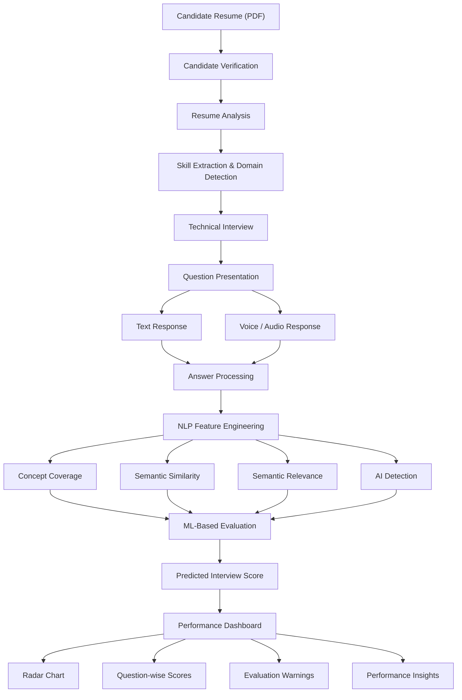

# 🎙️ AI-Powered Mock Interview Analyzer

### Intelligent Resume Analysis | Adaptive Technical Interviews | NLP | Machine Learning | Performance Intelligence

\<p align="center">   \   \   \   \   \ \</p>

\<p align="center">   \<b>Turn your resume into an intelligent technical interview experience.\</b>   \<br/>   Analyze skills, answer personalized questions, and receive automated ML-powered performance insights. \</p>

---

## 🌐 Live Application

🚀 **Live Demo:** [Launch AI Mock Interview Analyzer](#)

📂 **GitHub Repository:** [View Source Code](#)

---

## 💡 About the Project

The **AI-Powered Mock Interview Analyzer & Intelligent Skill Assessment System** is a machine learning-based web application designed to automate technical interview practice and candidate performance evaluation.

The application provides an end-to-end interview experience, starting with candidate verification and resume analysis, followed by technical questioning, answer evaluation, and an interactive performance report.

It analyzes candidate responses using NLP-based evaluation metrics and machine learning techniques to generate quantitative performance insights.

Unlike conventional mock interview systems, this application focuses on measurable answer quality, concept understanding, semantic relevance, and potential AI-generated response patterns.

### 🔄 Complete Application Workflow

**Resume Upload → Candidate Verification → Resume Analysis → Technical Interview → Answer Evaluation → ML-Based Assessment → Performance Dashboard**

---

## ✨ Key Features

### 📄 1. Candidate Verification & Resume Analysis

- Upload and analyze candidate resumes.
- Extract resume information using PyMuPDF.
- Identify technical skills, technologies, and relevant keywords.
- Analyze candidate profiles before starting the interview.

### 🧭 2. Intelligent Technical Interview

- Generate technical questions based on the candidate's profile and selected domain.
- Present questions through an interactive interview interface.
- Evaluate answers question by question.
- Support text-based and voice/audio response interaction.

### 🎤 3. Voice & Text-Based Responses

- Interactive answer submission interface.
- Audio-based response interaction.
- Voice waveform visualization in the interview interface.
- Text-based answer evaluation.

### 🧠 4. Advanced NLP-Based Answer Evaluation

The application evaluates candidate responses using multiple NLP and answer-quality metrics.

| Evaluation Metric   | Description                                                              |
| ------------------- | ------------------------------------------------------------------------ |
| Concept Coverage    | Measures how many important concepts are covered                         |
| Semantic Similarity | Evaluates contextual similarity between the answer and expected response |
| Semantic Relevance  | Measures how relevant the response is to the interview question          |
| Answer Quality      | Evaluates the overall quality of the response                            |
| AI Detection        | Identifies potential AI-generated response patterns                      |
| Question-wise Score | Provides individual scores for submitted answers                         |

### 🤖 5. Machine Learning-Based Scoring

The application uses a machine learning evaluation pipeline to generate predicted interview scores.

**Ensemble Model Architecture (as specified for the project):**

| Component    | Algorithm                   |
| ------------ | --------------------------- |
| Base Model 1 | Extra Trees Regressor       |
| Base Model 2 | Random Forest Regressor     |
| Base Model 3 | Gradient Boosting Regressor |
| Meta Model   | Ridge Regression            |
| Ensemble     | Stacking Regressor          |

The ensemble combines predictions from multiple regression algorithms to estimate candidate answer scores.

### 📊 6. Intelligent Performance Dashboard

The application generates a detailed **Interview Evaluation & Performance Report**.

Dashboard features include:

- Overall Interview Score.
- Concept Coverage.
- Semantic Similarity.
- AI Detection Percentage.
- Question-wise scoring.
- Radar chart visualization.
- Individual answer evaluation.
- Performance warnings and improvement insights.

**Example metrics displayed in the demonstration video:**

| Performance Metric  | Demo Result 1 |
| ------------------- | ------------: |
| Overall Score       |    84.1 / 100 |
| Concept Coverage    |         27.2% |
| Semantic Similarity |         15.0% |
| AI Detection        |         32.7% |

*These are demonstration-session values, not fixed model accuracy figures.*

### 🚨 7. Automated Evaluation Warnings

The system can display evaluation warnings when responses exhibit potential issues, including:

- Low semantic relevance.
- Suspicious AI-generated response patterns.
- Insufficient conceptual coverage.
- Answers requiring further technical explanation.

These warnings help candidates understand areas requiring improvement.

### ☁️ 8. Cloud Deployment

- Interactive Streamlit web interface.
- Cloud deployment using AWS EC2.
- Streamlit Community Cloud hosting support.
- Browser-accessible application.

---

## 🏗️ System Architecture



---

## ⚙️ Interview Evaluation Workflow

**1. Candidate Verification**

The application begins by verifying the candidate and preparing the resume analysis process.

**2. Resume Analysis**

The uploaded resume is processed to identify technical skills, experience, and relevant information.

**3. Technical Questioning**

The application presents technical interview questions for the candidate to answer.

**4. Answer Submission**

Candidates interact with the interview interface through text and voice/audio responses.

**5. NLP Processing**

The submitted responses are processed to calculate answer-quality and semantic evaluation metrics.

**6. Machine Learning Evaluation**

The extracted features are passed through the trained evaluation model to generate predicted scores.

**7. Performance Reporting**

The final report presents the overall score, individual question scores, radar visualization, and evaluation warnings.

---

## 🛠️ Technology Stack

| Category                 | Technologies                                     |
| ------------------------ | ------------------------------------------------ |
| Programming Language     | Python                                           |
| Frontend & Web Framework | Streamlit                                        |
| Machine Learning         | Scikit-learn                                     |
| Ensemble Learning        | Stacking Regressor                               |
| NLP                      | TF-IDF, Semantic Similarity, Feature Engineering |
| Resume Parsing           | PyMuPDF                                          |
| Voice Recognition        | SpeechRecognition                                |
| Data Processing          | Pandas, NumPy                                    |
| Data Visualization       | Plotly                                           |
| Model Serialization      | Pickle                                           |
| Cloud Infrastructure     | AWS EC2                                          |
| Deployment               | Streamlit Community Cloud                        |
| Development Tools        | Jupyter Notebook, VS Code, Git & GitHub          |

---

## 📂 Project Structure

```text
AI-Mock-Interview-Analyzer/
│
├── app.py
├── MODEL.ipynb
├── questions.csv
├── answer_evaluation.csv
├── ai_mock_interview_champion_model.pkl
├── requirements.txt
├── README.md
│
└── assets/
    ├── resume_analysis.png
    ├── interview_interface.png
    ├── performance_dashboard.png
    └── evaluation_report.png
```

---

## 🚀 Installation & Setup

### 1. Clone Repository

```bash
git clone YOUR_GITHUB_REPOSITORY_URL
```

### 2. Navigate to Project

```bash
cd AI-Mock-Interview-Analyzer
```

### 3. Create Virtual Environment

```bash
python -m venv venv
```

**Windows:**

```bash
venv\Scripts\activate
```

**Linux / macOS:**

```bash
source venv/bin/activate
```

### 4. Install Dependencies

```bash
pip install -r requirements.txt
```

### 5. Run Application

```bash
streamlit run app.py
```

Open the local URL displayed in your terminal.

---

## 📸 Application Preview

### 1. Candidate Verification & Resume Analysis


### 2. Interactive Technical Interview


### 3. Interview Evaluation & Performance Report


### 4. Detailed Evaluation & Analytics


---

## 🎯 Project Objectives

- Automate technical mock interview sessions.
- Provide resume-based candidate assessment.
- Evaluate technical answers using NLP and ML.
- Measure conceptual understanding and semantic relevance.
- Identify potential AI-generated response patterns.
- Generate structured performance reports.
- Help candidates identify technical knowledge gaps.

---

## 🔮 Future Enhancements

- LLM-powered dynamic interview question generation.
- Real-time answer feedback and recommendations.
- Improved semantic understanding using transformer models.
- Adaptive interview difficulty.
- Multilingual interview support.
- Historical performance tracking.
- Advanced speech and pronunciation analysis.

---

## 🔐 Responsible AI & Limitations

- Predicted scores are estimates and should not be treated as definitive judgments of candidate ability.
- AI detection metrics are indicative and are not proof that an answer was generated by AI.
- Semantic similarity does not independently establish technical correctness.
- Speech recognition may be affected by background noise and pronunciation.
- Model performance depends on training data quality and evaluation methodology.

---

## 👨‍💻 Developer

**Mohd Kaunain**

B.Tech – Computer Science & Engineering (Artificial Intelligence)

**Areas of Interest:** Artificial Intelligence | Machine Learning | Data Science | Natural Language Processing

---

## ⭐ Support the Project

If you find this project interesting:

- ⭐ Star this repository.
- 🍴 Fork the project.
- 🐛 Report bugs and issues.
- 🤝 Contribute to future improvements.

\<p align="center">
&#x20; \<b>Built with ❤️ using Python, Artificial Intelligence & Machine Learning\</b>
&#x20; \<br/>
&#x20; \<i>Making technical interview preparation smarter and more data-driven.\</i>
\</p>
