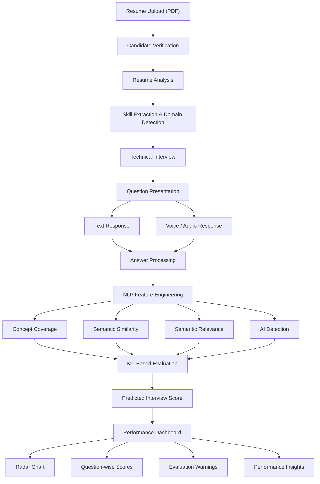

# 🎙️ AI Mock Interview Analyzer

### Intelligent Resume Analysis | Adaptive Technical Interviews | NLP | Machine Learning | Performance Intelligence

<p align="center">
  
  
  
  
  
</p>

<p align="center">
  <b>Turn your resume into an intelligent technical interview experience.</b>
  <br/>
  Analyze skills, answer personalized questions, and receive automated ML-powered performance insights.
</p>

<p align="center">
  <a href="https://ai-mock-interview-analyzer.streamlit.app/">
    
  </a>
</p>

---

## 🌐 Live Application

<p align="center">
  <a href="https://ai-mock-interview-analyzer.streamlit.app/">
    <b>🚀 LAUNCH AI MOCK INTERVIEW ANALYZER</b>
  </a>
</p>

**Application:** https://ai-mock-interview-analyzer.streamlit.app/

---

## 💡 About the Project

The **AI-Powered Mock Interview Analyzer & Intelligent Skill Assessment System** is a machine learning-based web application designed to automate technical interview practice and candidate performance evaluation.

The application provides an end-to-end interview experience, starting with candidate verification and resume analysis, followed by technical questioning, answer evaluation, and an interactive performance report.

It analyzes candidate responses using NLP-based evaluation metrics and machine learning techniques to generate quantitative performance insights.

### 🔄 Complete Application Workflow

**Resume Upload → Candidate Verification → Resume Analysis → Technical Interview → Answer Evaluation → ML-Based Assessment → Performance Dashboard**

---

## ✨ Key Features

### 📄 1. Candidate Verification & Resume Analysis
- Upload and analyze candidate resumes.
- Extract resume information using PyMuPDF.
- Identify technical skills, technologies, and relevant keywords.
- Analyze candidate profiles before starting the interview.

### 🧭 2. Intelligent Technical Interview
- Generate technical questions based on the candidate's profile and selected domain.
- Present questions through an interactive interview interface.
- Evaluate answers question by question.
- Support text-based and voice/audio response interaction.

### 🎤 3. Voice & Text-Based Responses
- Interactive answer submission interface.
- Audio-based response interaction.
- Voice waveform visualization.
- Text-based answer evaluation.

### 🧠 4. Advanced NLP-Based Answer Evaluation

| Evaluation Metric | Description |
|---|---|
| Concept Coverage | Measures important concepts covered |
| Semantic Similarity | Evaluates contextual similarity |
| Semantic Relevance | Measures answer relevance |
| Answer Quality | Evaluates overall response quality |
| AI Detection | Identifies potential AI-generated patterns |
| Question-wise Score | Provides individual answer scores |

### 🤖 5. Machine Learning-Based Scoring

The project uses an ensemble-based regression architecture for interview answer scoring.

**Stacking Ensemble Architecture**

| Component | Algorithm |
|---|---|
| Base Model 1 | Extra Trees Regressor |
| Base Model 2 | Random Forest Regressor |
| Base Model 3 | Gradient Boosting Regressor |
| Meta Model | Ridge Regression |
| Ensemble | Stacking Regressor |

### 📊 6. Intelligent Performance Dashboard

- Overall Interview Score.
- Concept Coverage.
- Semantic Similarity.
- AI Detection Percentage.
- Question-wise scoring.
- Interactive radar chart.
- Individual answer evaluation.
- Performance warnings and improvement insights.

**Example demonstration results**

| Metric | Demo Result |
|---|---:|
| Overall Score | 84.1 / 100 |
| Concept Coverage | 27.2% |
| Semantic Similarity | 15.0% |
| AI Detection | 32.7% |

*These are example session results, not model accuracy figures.*

### 🚨 7. Automated Evaluation Warnings

- Low semantic relevance.
- Potential AI-generated response patterns.
- Insufficient conceptual coverage.
- Answers requiring further technical explanation.
- Interview rule violation and termination handling.

### ☁️ 8. Cloud Deployment

- Streamlit web interface.
- AWS EC2 cloud infrastructure.
- Streamlit Community Cloud deployment.
- Browser-accessible application.

---

## 🏗️ System Architecture



---

## ⚙️ Interview Evaluation Workflow

1. **Candidate Verification:** Verify the candidate before starting.
2. **Resume Analysis:** Extract technical skills and experience.
3. **Technical Questioning:** Present domain-specific interview questions.
4. **Answer Submission:** Accept text and voice/audio responses.
5. **NLP Processing:** Calculate answer-quality and semantic metrics.
6. **Machine Learning Evaluation:** Generate predicted interview scores.
7. **Performance Reporting:** Display scores, charts, and improvement insights.

---

## 🛠️ Technology Stack

| Category | Technologies |
|---|---|
| Programming Language | Python |
| Web Framework | Streamlit |
| Machine Learning | Scikit-learn |
| Ensemble Learning | Stacking Regressor |
| NLP | TF-IDF, Semantic Similarity, Feature Engineering |
| Resume Parsing | PyMuPDF |
| Voice Recognition | SpeechRecognition |
| Data Processing | Pandas, NumPy |
| Visualization | Plotly |
| Model Serialization | Pickle |
| Cloud | AWS EC2 |
| Deployment | Streamlit Community Cloud |
| Development | Jupyter Notebook, VS Code, Git & GitHub |

---

## 📂 Project Structure

```text
AI-Mock-Interview-Analyzer/
│
├── app.py
├── MODEL.ipynb
├── questions.csv
├── answer_evaluation.csv
├── ai_mock_interview_champion_model.pkl
├── requirements.txt
├── README.md
│
└── assets/
    ├── resume_analysis.png
    ├── interview_interface.png
    ├── performance_dashboard.png
    └── evaluation_report.png
```

---

## 🚀 Installation & Setup

**1. Clone Repository**

```bash
git clone YOUR_GITHUB_REPOSITORY_URL
```

**2. Navigate to Project**

```bash
cd AI-Mock-Interview-Analyzer
```

**3. Create Virtual Environment**

```bash
python -m venv venv
```

**4. Activate Environment**

Windows:

```bash
venv\Scripts\activate
```

Linux / macOS:

```bash
source venv/bin/activate
```

**5. Install Dependencies**

```bash
pip install -r requirements.txt
```

**6. Run Application**

```bash
streamlit run app.py
```

---

## 📸 Application Screenshots

### Resume Analysis


### Technical Interview Interface


### Performance Dashboard


### Evaluation Report


---

## 🎯 Project Objectives

- Automate technical mock interview sessions.
- Provide resume-based candidate assessment.
- Evaluate technical answers using NLP and ML.
- Measure conceptual understanding and semantic relevance.
- Identify potential AI-generated response patterns.
- Generate structured performance reports.
- Help candidates identify technical knowledge gaps.

---

## 🔮 Future Enhancements

- LLM-powered dynamic interview question generation.
- Real-time answer feedback.
- Transformer-based semantic evaluation.
- Adaptive interview difficulty.
- Multilingual interview support.
- Historical performance tracking.
- Advanced speech and pronunciation analysis.

---

## 🔐 Responsible AI & Limitations

- Predicted scores are estimates, not definitive judgments of candidate ability.
- AI detection metrics are indicative, not proof of AI usage.
- Semantic similarity does not independently establish technical correctness.
- Speech recognition may be affected by background noise.
- Model performance depends on training data quality and evaluation methodology.

---

## 👨‍💻 Developer

**Mohd Kaunain**

B.Tech – Computer Science & Engineering (Artificial Intelligence)

**Areas of Interest:** Artificial Intelligence | Machine Learning | Data Science | Natural Language Processing

---

## ⭐ Support the Project

If you find this project interesting:

- ⭐ Star this repository.
- 🍴 Fork the project.
- 🐛 Report bugs and issues.
- 🤝 Contribute to future improvements.

<p align="center">
  <b>Built with ❤️ using Python, Artificial Intelligence & Machine Learning</b>
  <br/>
  <i>Making technical interview preparation smarter and more data-driven.</i>
</p>
